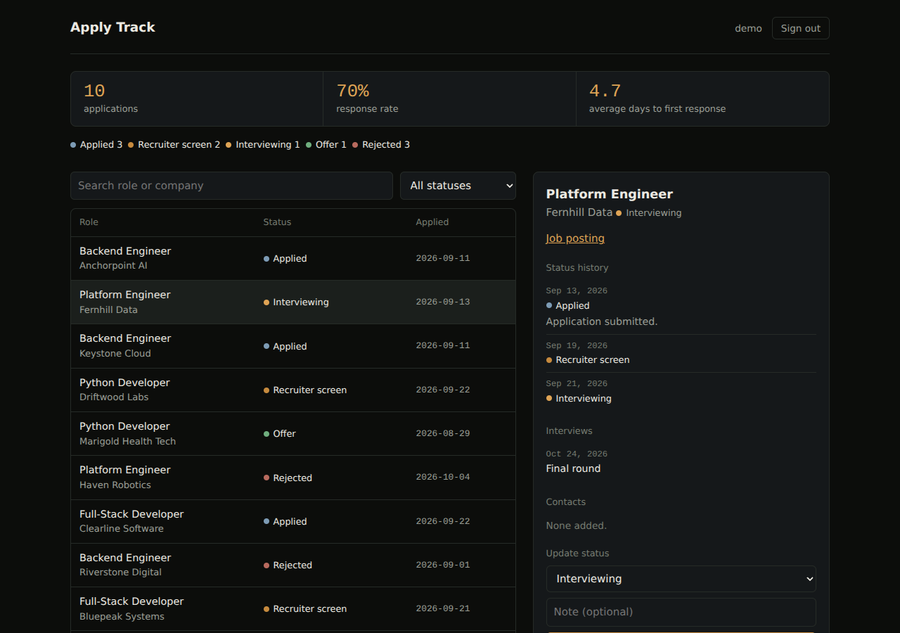

# Apply Track

A job-application tracker API built with Django and Django REST Framework. Track companies, applications, interviews and contacts, keep a full history of every status change, and get a dashboard of response rate and average days to hear back.

I built it to manage my own international job search, then made it a proper multi-user API. Every user sees only their own data, and that guarantee is covered by tests rather than just asserted.



## What it does

- JWT authentication (`djangorestframework-simplejwt`)
- Companies, applications, interviews and contacts, all through a REST API
- A **status history log**: every status change is recorded as its own event, so "how long did Acme take to reply?" is answered from real data, not guessed from a single overwritten field
- A `change-status` endpoint that updates the status and logs the event in one call
- Filtering, search, ordering and pagination on the application list
- A `/api/dashboard/` endpoint: totals, counts by status, response rate, average days to first response
- A configured Django admin, with status history, interviews and contacts shown inline on each application
- Production deployment files (gunicorn, systemd, an Apache reverse proxy, HTTPS) with a step-by-step guide, rate-limited login, and a nightly reset for a public demo
- A small demo page at `/` (plain HTML and JavaScript, no build step): sign in, see the dashboard, filter and search, open an application's history, change its status, and add new ones

## Run it

Requires Python 3.11+. On Python 3.11, `pip` installs Django 5.2; on 3.12 and later it installs Django 6.x (Django 6 dropped 3.11). The full test suite passes on both Django 5.2 and 6.1.

```bash
git clone https://github.com/akachukwuchukwu/apply-track.git
cd apply-track
python -m venv .venv && source .venv/bin/activate   # Windows: .venv\Scripts\activate
pip install -r requirements.txt

python manage.py migrate
python manage.py seed_demo_data     # optional: a demo user with 10 fictional applications
python manage.py runserver
```

Then open http://localhost:8000/ for the demo page and click **Fill demo account** (it needs the seed step above to have anything to show).

The seed command creates `demo` / `demo-password-123`, with fictional companies. It isn't anyone's real job search. To use the admin, run `python manage.py createsuperuser` and open http://localhost:8000/admin/.

Sensible development defaults are built into `settings.py`, so no `.env` is needed to try it. For anything real, copy `.env.example` to `.env` and set a proper `DJANGO_SECRET_KEY`.

## Configuration

Everything that differs between a laptop and a server comes from environment variables (or a local `.env`). The defaults suit development; production is `DJANGO_DEBUG=False` plus a real `DJANGO_SECRET_KEY`, and the app refuses to start in that mode without one.

| Variable | Default | Purpose |
|---|---|---|
| `DJANGO_DEBUG` | `True` | Set `False` in production |
| `DJANGO_SECRET_KEY` | development key | Required (32+ characters) when debug is off. Also signs the JWTs |
| `DJANGO_ALLOWED_HOSTS` | `localhost,127.0.0.1` | Comma-separated host names |
| `DJANGO_CSRF_TRUSTED_ORIGINS` | none | e.g. `https://demo.example.com`, for the admin over HTTPS |
| `DJANGO_BEHIND_PROXY` | `False` | Trust the proxy's `X-Forwarded-Proto` header |
| `DJANGO_NUM_PROXIES` | `0` | Reverse proxies in front of the app (1 behind Apache), used by the rate limiter |
| `DJANGO_LOGIN_THROTTLE` | `10/minute` | Login attempts allowed per client address |
| `DJANGO_DB_PATH` | `./db.sqlite3` | SQLite file location |
| `DJANGO_CACHE_DIR` | `./.django_cache` | Rate-limit counters |
| `DJANGO_SSL_REDIRECT`, `DJANGO_HSTS_SECONDS` | `False`, `0` | Optional hardening once HTTPS works |

## Deploying

[DEPLOYMENT.md](DEPLOYMENT.md) walks through putting this on a Linux server behind Apache with a Let's Encrypt certificate, one command at a time, and the `deploy/` folder holds the files it uses: the systemd service, the Apache site, the environment template, a nightly demo reset, and a `manage.sh` wrapper that runs management commands as the service user.

## Try the API

```bash
# 1. Get a token
curl -X POST http://localhost:8000/api/token/ \
  -H "Content-Type: application/json" \
  -d '{"username": "demo", "password": "demo-password-123"}'

# 2. Use it
curl http://localhost:8000/api/applications/?status=INTERVIEWING \
  -H "Authorization: Bearer <access token>"

# 3. Move an application along and log it
curl -X POST http://localhost:8000/api/applications/1/change-status/ \
  -H "Authorization: Bearer <access token>" \
  -H "Content-Type: application/json" \
  -d '{"status": "INTERVIEWING", "note": "Technical round booked"}'
```

| Endpoint | Purpose |
|---|---|
| `GET /` | The demo page |
| `POST /api/token/`, `/api/token/refresh/` | Obtain / refresh a JWT |
| `/api/applications/` | CRUD. Filter by `status` / `company`, `?search=`, `?ordering=` |
| `POST /api/applications/{id}/change-status/` | Update status and log a history event |
| `/api/companies/` | CRUD (one shared company list) |
| `/api/contacts/`, `/api/interviews/` | CRUD, scoped to your own applications |
| `GET /api/dashboard/` | Totals, counts by status, response rate, average days to response |

## Design decisions

- **Isolation lives in the queryset.** Each viewset's `get_queryset()` filters to the requesting user, so another user's record isn't forbidden, it simply doesn't exist from their point of view. That's why a request for someone else's application returns `404` rather than `403`: a `403` would confirm the ID exists.
- **A lighter serializer for lists.** The list endpoint skips the nested history, so paging through applications doesn't pull every related row for each one.
- **Status history is its own table.** `Application.status` is the current state; `StatusEvent` is the record of how it got there.
- **The average-days figure is computed in Python, not SQL.** SQLite's date arithmetic is limited and differs between databases, so this stays portable. It's fine at this scale; a high-volume version would push it into the database.
- **The page is one file with no build step.** Plain HTML, CSS and JavaScript in a single Django template: no bundler, no framework, nothing to install. It's a thin client over the same API anyone else would use.
- **API text is always rendered as text, never as HTML, and the login token lives in memory only.** A hostile company name can't inject script, and the token isn't sitting in `localStorage` for anything else on the page to read. The cost is that a refresh signs you out.
- **Production refuses unsafe settings.** With debug off, a missing, public or too-short secret key stops the app from starting, instead of quietly running on a key that is published in this repository.
- **Login is rate-limited per client address,** with the counters in a file-based cache so every gunicorn worker shares them. The number of trusted proxies is set explicitly: DRF's default trusts the client-supplied `X-Forwarded-For`, which would let an attacker dodge the limit by faking a new address each time.
- **The public demo can be reset safely.** `reset_demo_data --yes` deletes only the demo user's applications (and companies left with none) and reseeds, so it can run nightly without touching anyone else's data.
- **SQLite by default.** No setup to try it. Moving to Postgres means changing the `DATABASES` setting in `config/settings.py`; nothing else in the code is SQLite-specific.

## Tests

```bash
pytest
```

61 tests, no network needed. They cover the API, the status-change action, the dashboard maths (checked against hand-computed numbers), model behaviour, the demo page's wiring, login rate limiting, the production settings guards (run in a fresh process, because they fire at import time), the demo reset, and a dedicated file for data isolation between users.

The tests were also checked against deliberate breakage. Reverting the same-day-response fix failed a dashboard test, removing the ownership filter failed five of the eight isolation tests, and rendering API text with `innerHTML` instead of `textContent` failed the injection checks, and removing the rate limit, trusting the forged forwarded header, disabling the key guard, or making the reset delete every user's data each failed the tests written for it.

The demo page's JavaScript has its own end-to-end script in `ui-tests/`: 49 checks in a simulated browser against a live server, including wrong and right passwords, filtering, paging, session expiry, and an injection attempt. It needs Node and a freshly seeded database; the header of `ui-tests/e2e.js` has the exact steps.

## Bugs found while building this

- **An authorization hole, found by writing the isolation tests.** The viewsets hid other users' contacts and interviews on *read*, but the serializers accepted any `application` ID on *write*, so user B could attach records to user A's application and get a `201`. The "CRUD works" smoke test would never have caught it. Fixed by validating ownership in the serializer, with an error that mimics DRF's own "does not exist" message so callers can't use it to probe for valid IDs.
- **`auto_now_add` silently ignored explicitly passed timestamps.** `StatusEvent.changed_at` swallowed every explicit value, including the seed script's attempt to backdate history. Fixed by using `default=timezone.now`, which still gives "now" normally but can be set deliberately. There's a regression test.
- **A contradiction in the dashboard output.** It reported a 70% response rate alongside `average_days_to_response: null`. The seed data gave every application only an `APPLIED` event, even ones sitting at `OFFER`, so the current status disagreed with the history. Fixed the seed to build a full, consistent timeline.
- **The stats query counted the wrong events.** It only excluded `APPLIED`, so a `WISHLIST` event could be counted as a company replying, and `__gt` dropped same-day replies. Now it counts only real response statuses and uses `__gte`.
- **Admin edits bypassed the history log.** Changing a status in the admin didn't record an event, which breaks the invariant above. Fixed in `save_model`, with tests.
- **Layout problems only a real browser showed.** Screenshotting the page in headless Chromium showed a status note running into its badge, summary chips in alphabetical rather than pipeline order, and, on a phone, a tapped row appearing to do nothing because the detail panel sits below the whole list. All three fixed.
- **A publicly known signing key could have been used in production.** The development secret key is in this repository, and with debug switched off the app would still have accepted it. JWTs are signed with that key, so anyone could have forged a login token for any user. Now the app won't start in that state.
- **The login rate limit could have been bypassed.** DRF's default trusts the client's `X-Forwarded-For` header, so a different fake address on every request gave unlimited attempts. `NUM_PROXIES` is now set explicitly, and the behaviour was checked through a real Apache proxy.
- **A deployment rehearsal found a startup error.** gunicorn 26 tries to create a control socket in the service user's home directory, which `www-data` can't write to. Disabled with `--no-control-socket`, and the version is pinned to the one that was tested.

## Known limitations / what I'd build next

- **A fuller UI.** The page is a demo client, not a product: it can add applications and change statuses but not edit or delete records, and it doesn't use the refresh token, so you're sent back to sign in after an hour
- **Postgres and Docker.** The database location is already configurable, but a Postgres setup and a container image aren't done
- **Refresh-token blacklisting on logout**, so a stolen refresh token can be revoked
- **Interactive API docs** via `drf-spectacular`
- **Follow-up reminders**, e.g. flagging applications with no reply after N days
- **CI** running the test suite on every push
- Companies are one shared list across all users, which is fine for a personal tool but would need scoping for a real multi-tenant product

## License

MIT
